# 静读操作指南

给文字留一点空白，也给自己的想法留一个位置。

这本指南介绍静读当前的日常使用方法，包含 **AI 阅读助手的配置、选文提问、窗口模式与保存回答**。你可以像阅读其他电子书一样翻页，也可以打开右上角的“目录”，直接跳到需要的章节。图中的书籍和笔记是演示内容，不是你的个人资料；AI 图示使用示例回答，只说明操作方式。

## 一、从这里开始

### 打开内置指南

在“我的书架”右上方点击 **使用指南**，即可打开本书，不需要另外下载。

第一次打开后，指南会出现在书架上。以后可以直接点击它的封面继续阅读，阅读位置会像其他书籍一样保存。即使从书架删除了指南，也可以再次点击“使用指南”重新添加。

**应用更新后，请从首页“使用指南”入口打开应用随附的新版。** 书架中已保存的旧指南是独立副本，不会自动覆盖；新版内容有变化时会新增一本指南，旧版的阅读记录、标注与思考继续保留。同一份新版反复打开不会增加副本。

### 三步开始阅读

1. 在书架点击 **＋ 添加书籍**，选择一本 `.epub` 文件。
2. 使用 **下一页** 按钮或键盘下方向键阅读。
3. 读完后点击左上角的 **静读** 返回书架；下次点击书籍封面继续阅读。

> 普通阅读与标注不需要注册账号，书籍在本机处理。AI 阅读助手是可选功能，需要你自行配置 DeepSeek API Key；主动提问时，相关选文、问题及必要会话历史会发送给 DeepSeek。

## 二、添加书籍与认识书架

### 添加一本书

在“我的书架”找到 **＋ 添加书籍** 卡片，点击后选择 EPUB 文件。也可以把一本 EPUB 文件拖到这张卡片上，松开鼠标完成添加。

- 每次添加一本书，完成后可以继续添加下一本。
- 单本文件不超过 **20 MB**。
- 当前支持可重排版的 EPUB 电子书，不支持 PDF、MOBI、带阅读保护的电子书或固定版式 EPUB。
- 如果再次添加的是同一份文件，会打开已有书籍，不会因为改了文件名就重复添加。

### 看懂书籍卡片

书籍卡片显示封面、书名、作者与阅读进度。点击封面或书名即可阅读，最近读过的书会靠前排列。

卡片下方的 **标记、高亮、思考** 是该书的笔记入口。点击对应标签，可以直接查看该书这一类笔记。

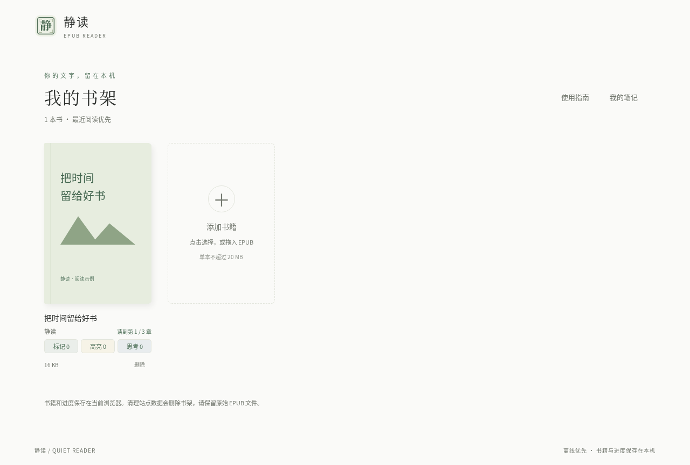

没有封面的书也可以正常阅读，静读会为它显示文字封面。

## 三、阅读与翻页

### 认识阅读界面

顶部显示书名、作者和当前章节；右上角依次是 **笔记**、**目录** 与 **设置**。底部提供 **上一页、下一页**、章节页码和 **专注阅读**。

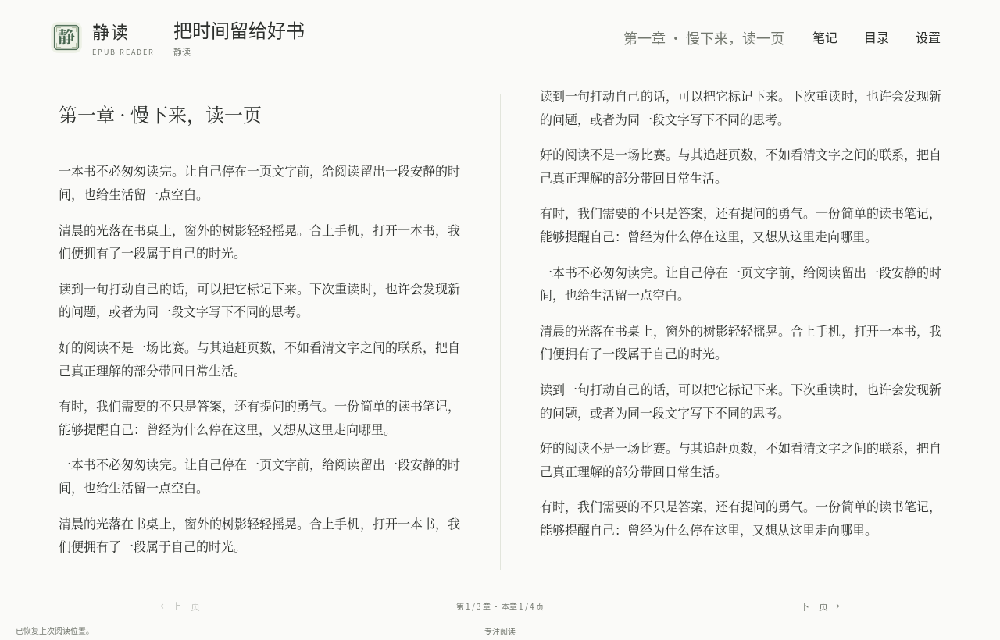

### 鼠标与键盘翻页

- 点击 **下一页**，或按键盘 `↓`、`→`：向后阅读。
- 点击 **上一页**，或按键盘 `↑`、`←`：返回前一页。
- 在输入思考或搜索文字时，方向键用于输入框操作，不会误翻正文。

窗口较宽时，正文会显示为双栏；窗口变窄时会自动改为单栏。不需要手动切换。

双栏阅读一次翻页可能移动两个页面。底部显示的是 **第几章 / 共几章，以及本章第几页 / 共几页**，不是全书阅读百分比。

### 继续上次阅读

阅读位置会自动保存。返回书架、关闭后再次打开同一本书时，会定位到上次的位置。

改变字号或窗口大小会重新分页，因此页码可能变化，但仍会尽量保留你的阅读位置。

窄屏下，过长的章节标题会单行显示省略号，不会出现横向滚动条。把鼠标停在章节标题上，可以查看完整文字。

## 四、使用章节目录

点击右上角的 **目录** 打开章节列表。当前章节会被标记，列表也会定位到附近，方便查找前后章节。

点击一个章节，正文会跳到对应位置。点击目录面板的 **×**，或按 `Esc`，可以关闭弹框。

点击 **章节目录** 标题前的 **图钉**，可以把目录固定在侧边。正文、顶部工具栏与底部翻页区会在剩余空间内重新排版，不会被目录遮挡。目录的章节列表可以独立滚动，**章节目录** 标题始终在顶部；切换章节、翻页或进入专注阅读时，固定目录仍会保留。

再次点击图钉可取消固定、恢复为弹框；点击 **×** 或顶部 **目录** 按钮可关闭固定目录。`Esc` 只关闭临时弹框，不会解除固定。固定状态会自动保存，下次打开书籍仍然沿用。

有些电子书包含分层目录，小节会向内缩进。有些书没有提供目录，此时不能通过目录跳转，但仍可逐页阅读。

想把目录面板放到另一侧，请到 **设置 → 目录显示位置** 选择左侧或右侧。这个设置只改变面板的位置，不改变右上角目录按钮的位置。

## 五、调整外观与进入专注阅读

### 选择适合自己的阅读外观

点击右上角的 **设置**：

- **明亮**：浅色背景，适合日常阅读。
- **护眼**：暖色纸张背景。
- **深色**：深色背景，适合偏暗的环境。
- **文字大小**：拖动滑块调整正文大小，可选 14～32 px。
- **目录显示位置**：选择目录从左侧或右侧打开。

设置会自动保存，下次阅读会沿用。需要重新开始时，点击 **恢复默认设置**，即可恢复明亮主题、16 px 字号和左侧目录，并解除目录固定。

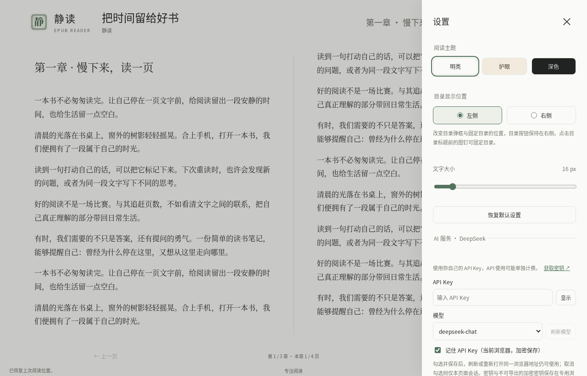

### 专注阅读

点击底部的 **专注阅读**，可隐藏品牌和操作按钮，把更多空间留给正文。

专注模式在所有屏幕宽度下，书名与作者都靠左、章节标题靠右；品牌与操作按钮不再保留占位，长章节标题仍然使用省略号。固定目录时，左右对齐以剩余阅读区域为准。退出时会恢复普通阅读布局。

点击底部的 **显示工具栏**，或按 `Esc`，可回到普通阅读。若当前还打开着思考窗口或面板，`Esc` 会先处理当前窗口。

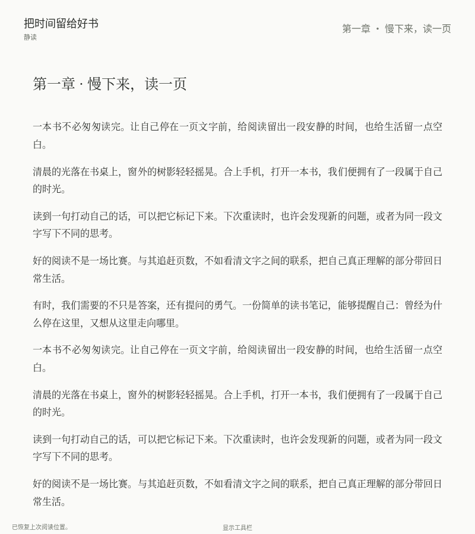

## 六、给文字做标注与高亮

### 选中一段文字

在正文中按住鼠标左键拖选文字，松开后会出现选文工具条。

### 划线与高亮

- 在 **标注** 区域选择实线、虚线或波浪线。
- 在 **高亮** 区域选择黄色、绿色、蓝色或粉色。
- 再次点击当前已选的线型或颜色，可以取消这一项。
- 点击另一种线型或颜色，可以切换这一项。

划线、高亮和思考相互独立。同一段文字可以同时有划线、高亮和思考，取消划线或高亮不会删除已经保存的思考。

窄小的触屏界面可能把高亮颜色收在展开按钮中，展开色板后选择即可。

鼠标停在已标注的文字附近，或点击正文中的 **标记 / 思考** 小标签，可以查看摘录预览、追加思考或进入笔记页面。

> 标注通常会立即保存。如果出现保存失败提示，请不要清理本机数据；保留当前内容，检查存储空间后再重试。

## 七、写思考、保存与恢复草稿

### 写一条思考

选中文字后，在选文工具条点击 **思考**，即可打开“写思考”窗口。

在正文输入框中写下自己的想法。窗口会自动适应内容长度，也可以拖动标题栏调整位置；点击 **出处** 可以查看完整来源。

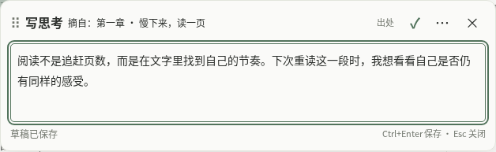

### 正式保存与草稿的区别

- 点击顶部 **✓**，或按 `Ctrl + Enter`，会保存为正式思考并收起窗口。Mac 键盘使用 `⌘ + Enter`。
- 输入后稍等片刻，底部会显示 **草稿已保存**。草稿保存在本机，但还不是正式思考。
- 点击 **×** 或按 `Esc` 关闭思考窗口，会先保留草稿，不会把它自动变成正式思考。
- 按 `Ctrl + S`，或 Mac 上的 `⌘ + S`，可以立即保存当前草稿。
- 顶部 **⋯ 更多操作 → 丢弃本次草稿** 用于放弃本次输入；非空草稿会要求确认。

关闭窗口后，如果有本机草稿，可通过界面上的 **本机草稿 · 恢复 / 丢弃** 入口，或“我的笔记”中的本机草稿列表恢复。

> “草稿已保存”不等于“正式思考已保存”。需要计入思考数量或导出备份时，请先点击 ✓ 正式保存。

同一段摘录可以追加多次思考，后续复读时不必覆盖前一次的想法。编辑已有思考时，只有正式保存后才会更新原思考。

如果提示草稿或正式保存失败，窗口中的输入会保留。不要立即关闭应用，先根据提示重试。

## 八、查看、搜索与管理笔记

### 打开笔记页面

- 阅读时点击右上方 **笔记**（在 **目录** 前面）：默认查看正在阅读这本书的笔记，书籍范围显示该书名称，即使尚无笔记也会显示真实书名。可手动切换为 **全部书籍**；点击 **返回阅读** 可回到刚才的位置。
- 返回书架后，点击右上方 **我的笔记**：查看全部书籍的笔记。
- 点击书籍卡片下方 **标记、高亮、思考**：查看该书的对应分类。
- 从正文摘录预览中选择 **在笔记中查看**：查看该书笔记及对应思考。

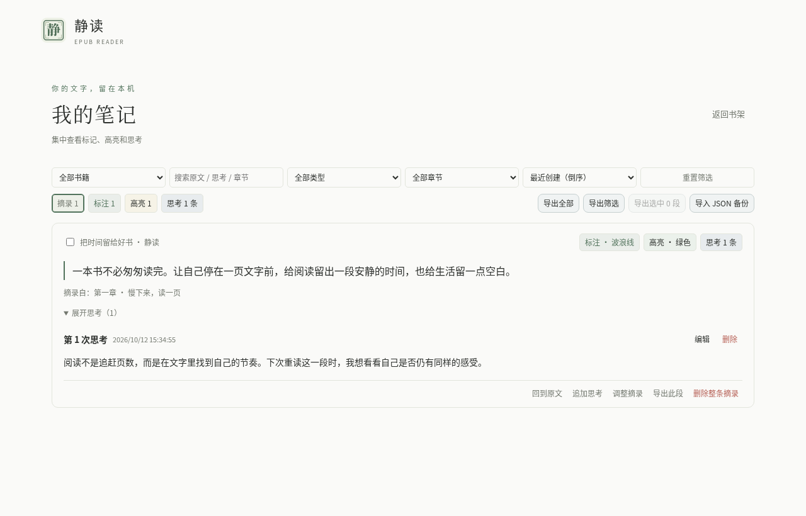

### 查找需要的内容

顶部可以选择笔记范围、类型、章节和排序方式。默认按最近创建的顺序显示，也可以改为原书顺序或最近修改。

搜索框可以搜索 **摘录原文、自己的思考和章节信息**。输入多个关键词时，结果需要同时匹配这些关键词。

命中文字会高亮，命中的思考会自动展开。点击 **清除搜索** 或 **重置筛选**，可以重新查看完整列表。搜索高亮只影响显示，不会改动你的笔记。

### 操作一段摘录

每张摘录卡片提供：

- **回到原文**：打开原书并定位到摘录位置。
- **追加思考**：为这段文字再写一条想法。
- **调整摘录**：修改标题、样式或重新选择摘录范围。
- **导出此段**：只导出这段摘录及其已保存思考。
- **删除整条摘录**：删除这一段及关联内容，操作前会要求确认。

展开思考后，每一条思考都可以单独 **编辑** 或 **删除**。

## 九、调整已有摘录

在“我的笔记”中找到摘录，点击 **调整摘录**。静读会打开对应书籍并显示调整窗口。

你可以修改 **自拟标题**、线型、线色和高亮颜色。要扩大或缩小摘录范围，直接在正文重新拖选文字，然后查看新的摘录预览。

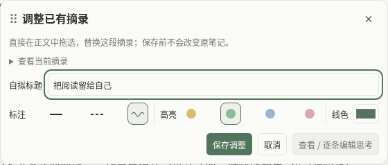

点击 **保存调整** 后才会更新，原来的思考会保留。点击 **取消**，或在未保存提示中选择 **放弃修改**，则不改动原摘录。

如果原书已被删除，请先重新添加同一份 EPUB，才能回到原文或调整范围。只恢复笔记备份并不会自动恢复原书。

## 十、导出笔记与恢复备份

### 选择要导出的范围

在“我的笔记”中，可以导出全部、本书、当前筛选结果，或勾选多张摘录后导出选中内容。单张卡片的 **导出此段** 用于导出一段。

### 选择合适的格式

打开导出窗口后，选择格式并下载：

- **Markdown**：适合阅读、整理和分享笔记。
- **JSON**：用于恢复笔记的备份格式。
- **ZIP**：同时包含阅读版笔记与可恢复的备份。

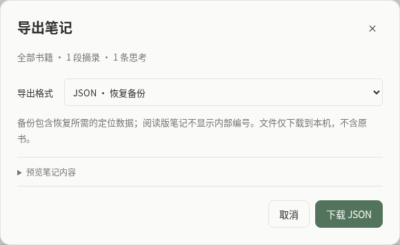

导出只包含已正式保存的笔记和思考，**不包含原始 EPUB、阅读进度、阅读设置或未提交草稿**。有需要保留的草稿时，请先恢复并正式保存。

### 恢复 JSON 备份

点击 **导入 JSON 备份**，选择之前保存的 JSON 文件。若你保存的是 ZIP，请先解压并取出其中的 JSON 备份。

恢复前会显示新增、重复和冲突内容。遇到冲突时，逐项选择保留本机内容还是使用备份中的内容，再点击 **确认恢复**。

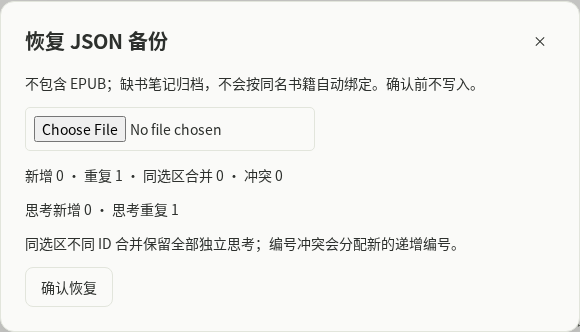

恢复后，缺少原书的笔记会显示为 **原书未载入 · 归档笔记**。它们仍可查看、编辑和导出，但需要重新添加对应原书才能回到原文。

恢复笔记不会恢复书架中的书籍文件。请把原始 EPUB 和笔记备份一起妥善保管。

## 十一、删除与误操作保护

### 从书架删除一本书

点击书籍卡片下方的 **删除**，查看确认窗口。

删除会移除这本书在静读中的本地副本、封面和阅读记录，**不会删除你在其他文件夹保留的原始 EPUB**。

默认保留这本书的笔记归档。如果确实要连同笔记和草稿一起删除，需要勾选 **一并清理笔记及草稿**；建议先导出备份。

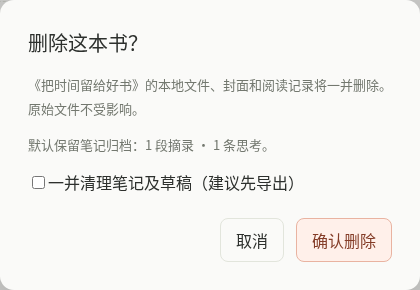

### 删除摘录或单条思考

删除摘录或思考前，确认窗口会说明将删除的内容。删除后，页面右下角会短暂显示 **撤销**。

误删时请在 **10 秒内** 点击撤销。超时或刷新页面后，撤销入口会失效。这个撤销功能不用于恢复被删除的书籍文件。

若遇到未保存的摘录调整，静读会提示先保存、放弃或继续编辑，不会直接覆盖原摘录。

## 十二、配置 AI 阅读助手

### 准备自己的 DeepSeek API Key

AI 阅读助手帮助解释书中的术语或段落，不是阅读书籍的必需功能。目前使用 **DeepSeek**，费用由你自己的 API 账户承担；官网登录或订阅与 API 使用额度不一定相同，请以平台说明为准。

1. 阅读任意一本书，点击右上角 **设置**，向下找到 **AI 服务 · DeepSeek**。
2. 点击 **获取密钥 ↗**，打开 DeepSeek 的密钥管理页面。桌面版使用系统浏览器；可能需要先登录官网。
3. 在官网自行创建 API Key，复制后粘贴到静读的 **API Key** 输入框。不要把密钥发送给其他人或写进笔记。
4. 在 **模型** 下拉框选择模型。需要更新可用列表时，点击 **刷新模型**；如果输入了新密钥，刷新会使用新密钥读取列表。
5. 选择是否记住密钥，点击 **保存配置**。看到“AI 配置已保存”后即可使用。
6. 可点击 **测试连接** 验证当前填写的密钥和所选模型。测试会发送极短问题，可能产生少量费用；测试成功不代表你已点击保存。

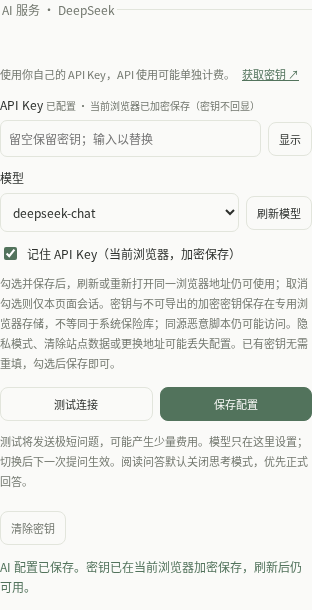

### 记住密钥与仅当前会话

- **桌面版**：勾选 **安全记住新密钥（系统凭据存储）** 并保存，重启后仍可使用。不勾选则只在本次应用会话中可用。
- **浏览器版**：勾选 **记住 API Key（当前浏览器，加密保存）** 并保存，刷新或重开同一浏览器地址仍可使用。不勾选则仅当前页面可用。
- 已配置的密钥不会重新显示在输入框里。留空可保留旧密钥；输入新密钥再保存会替换旧密钥。
- 已配置密钥后，改变“记住”勾选并保存，无需重新填写；取消记住会移除已保存的凭据，但仍可在当前会话使用。
- **清除密钥** 需要确认，只清除 AI 密钥，不删除书籍、笔记或阅读设置。

浏览器加密保存不等同于系统保险库，同一站点中的恶意脚本仍可能访问。隐私模式、清除站点数据、更换浏览器用户或访问地址可能使配置丢失，请妥善保管官网密钥。

### 修改模型

模型只在这里选择并保存，**下一次提问** 使用新配置。已经生成的回答仍显示当时实际使用的模型，不会被改成新模型。不要只根据模型名字判断费用或能力，以 DeepSeek 当前账户可用列表与官方说明为准。

如果“获取密钥”无法打开，可复制 `https://platform.deepseek.com/api_keys` 到浏览器。连接失败时，先检查网络、密钥是否有效、API 账户额度与模型是否可用；不要反复重试收费请求或清理阅读数据。

## 十三、选文提问与追加引用

### 第一次提问

1. 在书籍正文中拖选术语或一段文字。
2. 松开鼠标，在选文工具条点击 **问 AI**。
3. 助手会显示 **引用 1**、原文、书名和章节来源。打开助手本身不会发起提问请求。
4. 点击 **解释术语、通俗解读、举例说明**，可立即发送对应问题；也可以在下方输入自己的问题并按 **Enter** 发送。

**Shift + Enter** 换行。当前输入区没有单独的发送按钮；中文输入法正在选字时，Enter 用于确认输入，不应当发送问题。

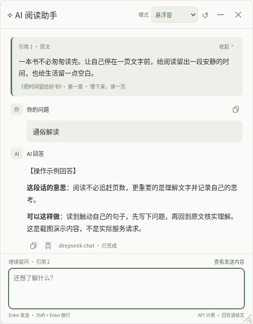

如果尚未配置密钥，助手会提示 **前往设置**。你可以先配置，再继续提问，不必因为没有密钥就放弃阅读。

### 阅读下一段后继续讨论

在同一本书中再选一段文字，点击 **问 AI**，会追加 **引用 2、引用 3……**，保留现有问题和回答。仅仅选中文字，不会改变助手引用；追加引用也不会自动发送问题或中断正在生成的回答。

带有 **当前提问** 标记的引用，是下一个问题的主要原文。旧回答仍留在其原引用下，保存旧回答时也关联原来的摘录，不会错误地保存到最新选文。

已有会话中，再次点击“问 AI”不会强制切换你正在使用的窗口模式。要为另一段文字提问，先追加引用，再说明具体问题，例如“这里的说法与前一段有什么区别？”

### 查看发送内容与阅读回答

点击输入区上方 **查看发送内容**，可以预览相关原文、问题和会话内容。应用只带上相关引用和有限的最近问答，不保证发送全部长会话历史，也不会因为打开一本书就自动上传整本书。

回答会逐步显示，底部标明本次实际模型和 **已完成／生成中／未完成** 状态。生成时可点击输入框外的 **停止生成**。停止后已收到的文字仍可查看，但可能不完整；**重试此问题（可能再次计费）** 会重新发起请求。

回答旁的复制图标可以复制内容。AI 可能误解上下文或给出错误信息，涉及事实、引用、法律或财务判断时，请回到原文并核实可靠来源。

## 十四、助手模式、保存回答与会话保护

### 三种呈现模式

在助手右上方的 **模式** 下拉框切换：

- **向右扩展**：桌面版的新会话默认先尝试这一模式，在主窗右侧增加助手区域，尽量保留原阅读区。主窗已最大化、全屏或横向工作区放不下时，使用独立窗口，不强行缩小正文。固定目录与专注阅读仍可同时使用。
- **独立窗口**：助手单独显示，可移动、最小化或最大化。桌面版标题栏跟随阅读主题；关闭这个助手窗口不会退出主阅读器。
- **悬浮窗**：助手在阅读器内浮动，可拖动标题栏、调整大小、收起再展开；**重置悬浮窗位置与大小** 可找回偏离位置的窗口。

浏览器不提供原生向右扩展，首次通常打开右侧独立助手；主浏览器不被移动或缩小。弹窗被拦截时可允许弹窗或改用悬浮窗。浏览器自动跟随只是尽力对齐；若移动会改变助手尺寸，应用会暂停跟随，可手动并排。网页会沿用你保存的模式偏好。

**切换模式或收起悬浮窗会保留本次问答和输入，不会重新请求 AI。** 桌面新会话仍先尝试扩展；当前会话中手动选择的模式会继续保持。

### 把回答保存为自己的思考

1. 等回答完成，点击该回答下方的 **保存为思考** 图标。
2. 主阅读窗口会打开已有的 **写思考** 编辑器，带入问题、回答和模型来源说明；独立助手模式下请回到主阅读窗口查看。
3. 根据需要删改、补充自己的理解，再点击 **✓ 保存并收起**，或按 **Ctrl + Enter**（Mac 用 **⌘ + Enter**）正式保存。
4. 保存后可在本书笔记中查看、编辑和导出。助手中的按钮会变成 **已保存为思考**，避免同一回答重复保存。

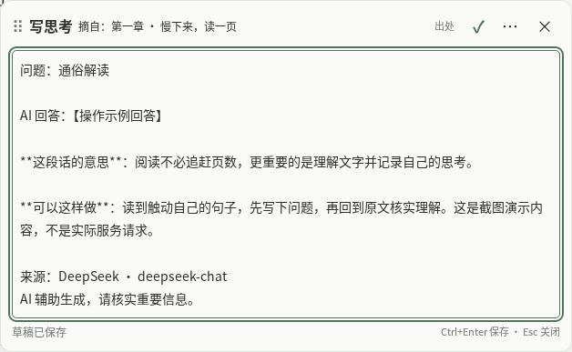

**点击“保存为思考”只是进入编辑器，不会自动成为正式笔记。** 编辑器沿用草稿保护；未正式保存的内容需要恢复后保存，才会计入笔记并参与导出。未完成但已有文字的回答也可能允许保存，请保留“回答未完成”提醒并仔细核实。

### 关闭、换书与隐私

关闭助手会停止正在进行的生成，并清空 **尚未保存的本次问答和问题输入草稿**；换书时不要依赖旧会话继续保留。需要留下的回答，请在关闭或换书前保存为思考。

关闭助手不会清除 API Key，也不会删除已保存思考；“写思考”编辑器的本机草稿与助手问题输入是两种不同的内容，不要混淆。

> 普通阅读、标注和笔记保存在本机。只有你主动提问、点击快捷提问、重试或测试连接时，才会产生对应的 AI 请求；刷新模型会联系服务商读取模型列表。提问会发送相关选文、问题及必要历史，可能暴露书中或输入中的敏感信息，费用由你的 API 账户承担。

当前功能是 **选文阅读问答**，不是“上传全书后永久记忆”。如果问题需要未提供的前后章节，请先追加合适的引用，不要假定助手已经读过整本书。

## 十五、常用快捷键

### 阅读时

- `↓` 或 `→`：下一页。
- `↑` 或 `←`：上一页。
- `Esc`：关闭当前面板或窗口；在没有其他窗口时退出专注阅读。
- `Tab`：依次访问可操作的按钮。
- `Enter` 或空格：激活当前选中的按钮。

### 写思考时

- `Ctrl + Enter`：正式保存并收起；Mac 使用 `⌘ + Enter`。
- `Ctrl + S`：立即保存草稿；Mac 使用 `⌘ + S`。
- `Esc`：关闭并保留草稿；若已展开更多操作，先关闭更多操作。

### 在 AI 助手中

- 在问题输入区按 `Enter`：发送问题（中文输入法选字时先确认输入）。
- `Shift + Enter`：在问题中换行。
- `Esc`：先关闭已展开的发送内容预览，否则关闭助手并清空未保存会话。
- AI 回答转入“写思考”后，使用写思考的保存与草稿快捷键。

输入文字时，方向键不会触发正文翻页。快捷键需要在静读窗口内使用。

## 十六、数据保护与常见问题

### 如何保管自己的阅读资料

静读没有阅读账号和自动云同步，书籍、阅读进度、设置、笔记与草稿保存在当前设备的本机存储中。可选 AI 助手另用你的 DeepSeek API 账户；主动发出的 AI 资料会交给该服务商处理，阅读本身与 AI 服务应分开理解。

建议：

1. 保留原始 EPUB 文件，不能只依赖书架中的副本。
2. 定期把正式笔记导出为 JSON 或 ZIP 备份。
3. 更换设备或清理应用、浏览器数据之前，先完成备份。
4. 不要把隐私浏览窗口当作长期书架。

如果使用浏览器打开静读，请保持同一个浏览器、同一个浏览器用户配置和同一个访问地址。换浏览器或换地址后看到空书架，并不一定代表原来的数据已丢失。

### 可以离线阅读吗

书籍已经添加、应用已经打开后，可以在不联网的情况下继续阅读。内置操作指南随静读提供，不需要在线下载；AI 提问、测试连接及刷新模型需要联网。

如果你使用的是浏览器形式，重新打开页面时仍需要本机的静读程序处于运行状态。离线阅读不代表可以关闭本机程序后仍重新打开网页。

### 文件无法打开怎么办

检查文件是否是完整的 EPUB、是否超过 20 MB，以及是否带阅读保护或采用固定版式。可以尝试另一份可重排版 EPUB；原始文件应继续保留。

### 为什么没有某本书的目录或封面

这取决于书籍自身是否提供有效的目录与封面。不影响逐页阅读；缺少封面时，书架会显示文字封面。

### 为什么字号改了以后页码也变了

字号、窗口宽度与单栏 / 双栏都会影响分页。静读以阅读位置继续定位，不保证变化前后的页码数字完全一致。

### 为什么“草稿已保存”却没有增加思考数量

草稿与正式思考不同。恢复草稿后点击顶部 ✓，或按正式保存快捷键，才会计入思考数量并参与导出。

### 提示保存失败怎么办

保留输入与原始文件，先检查设备空间，再根据提示重试。不要为解决保存失败而直接清理应用或浏览器数据，那可能连已有的阅读记录与笔记一起删除。

### 删除后还能找回吗

原始 EPUB 如果保留在自己的文件夹中，可以重新添加。笔记可从 JSON 备份恢复；刚刚删除的摘录或思考，也可以在撤销提示仍有效时立即撤销。

没有原始书籍、备份或有效撤销记录时，静读不能保证恢复已删除的数据。

愿这本指南帮你把注意力留给阅读，而不是留给操作。
